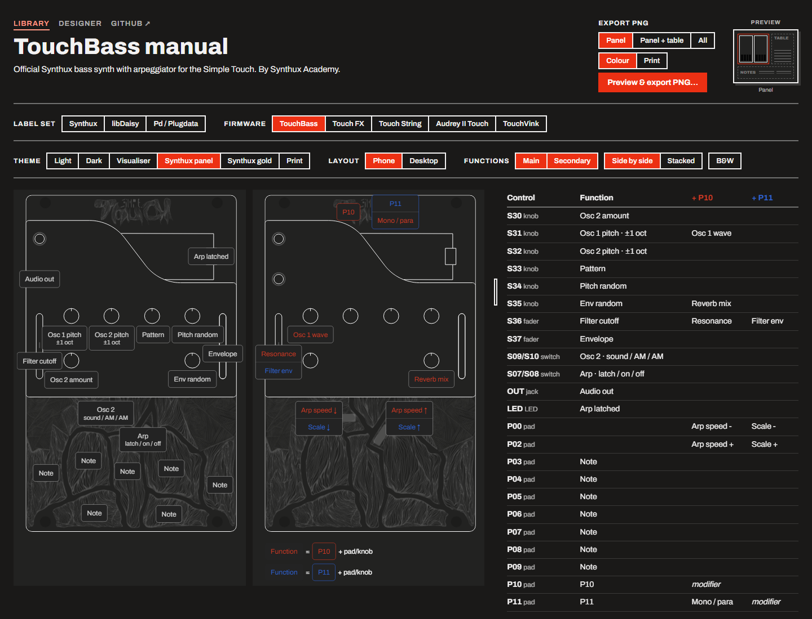
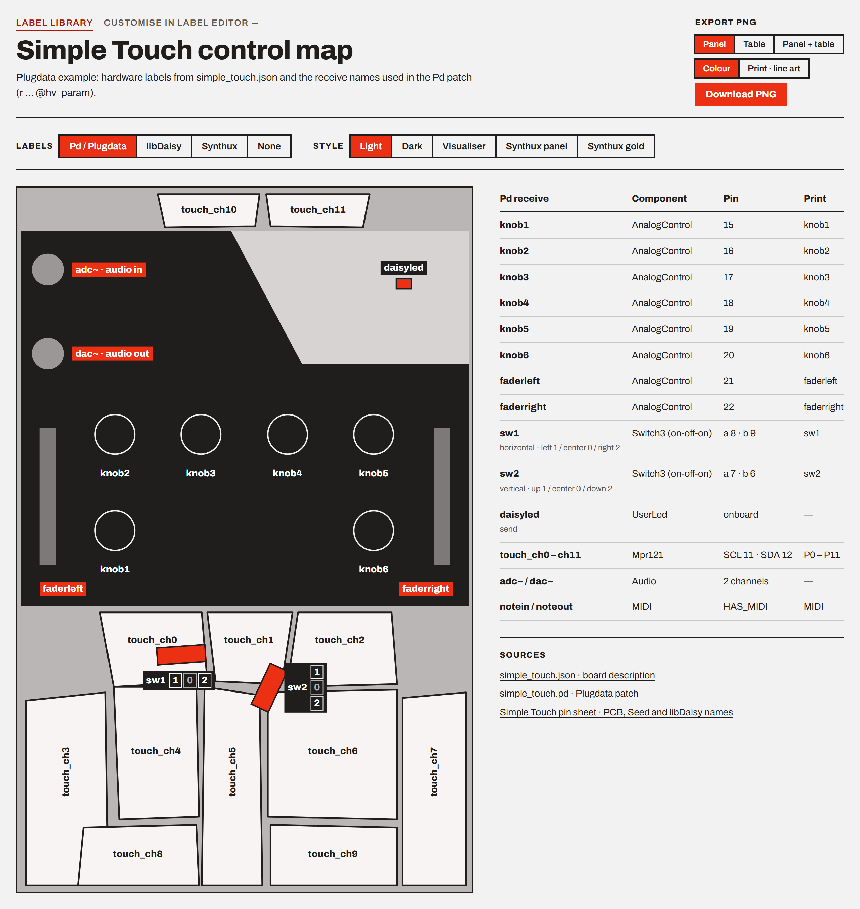

# Simple Touch labels

Control maps, manuals and a manual designer for the Synthux Simple Touch (Daisy Seed).

- **Library**: https://jonwaterschoot.github.io/simple-touch-labels/
- **Designer**: https://jonwaterschoot.github.io/simple-touch-labels/editor.html

## Examples

| Library · TouchBass · Synthux panel | Library · Pd / Plugdata · Light |
| --- | --- |
|  |  |

## Pages

- `index.html`: the library. Reference maps with Synthux, libDaisy and Pd / Plugdata names (with their pin tables), and manuals for TouchBass, Touch FX, Touch String and Audrey II Touch, with labels checked against each firmware's repo. Accepts `?src=sx|ld|pd|touchbass|touchfx|touchstring|audreytouch|touchvink&theme=…&layout=phone|desktop`. The Community picker lists the Simple Touch entries of the [Synthux community directory](https://synthux-academy.github.io/community-instruments/) (read from its `projects.json`, leaving out those already above); open one with `?community=<id>`. Its labels come from the repository's `simple-touch-labels.json` if it has one (made in the designer), else they are auto-extracted from its README and a linked manual, marked as such with the line each label came from. Controls without a label show the Synthux names.
- **Creator theme**: a label file made in the designer carries its creator's look (colours, sizes, drawing, a Google font) and can name a faceplate SVG in the same repository. The library then shows it in that look first, as the Creator theme next to its own; the faceplate shows in every theme. Values from the file pass only as plain numbers, colours and known words, and the faceplate is cleaned like an upload. `?preview` shows the designer's current state in this browser the same way, and follows its edits.
- **Play**: when a firmware's label file has a browser build its author approved (an `emulator` block, see below), the library shows a Play button. The firmware then runs in the page, built with [simple-touch-web](https://github.com/jonwaterschoot/simple-touch-web): drag the knobs and faders on the drawing, click the levers, press the pads (higher up on a pad is harder). The keyboard plays the pads by key position: 3 4 · W E R · A S D F G · X V on QWERTY, " ' · Z E R · Q S D F G · X V on AZERTY (the key names follow the layout you pick). Web MIDI connects a MIDI keyboard to the firmware's USB MIDI input and its output to a device. The control table lights the rows of the controls in use and shows the last MIDI message in and out; when the label file gives the controls' MIDI, each control's row also shows its last value in or out, and a note into a pad's note presses that pad on the drawing. A control, its label and its table row light together: lightly while you point at any of them (also when not playing), strongly while the control is in use or MIDI moves it. Its LED and OLED show on the panel. On a phone, Lock scroll (on by default on touch screens) keeps touches on the drawing from scrolling the page, and Full screen shows the drawing alone, with the sound controls in a sheet and the pad labels optional. A loop, the mic or a sound file of your own goes into its input. TouchVink is the first.
- `editor.html`: the designer. Accepts `?start=blank|touchbass|touchfx|touchstring|audreytouch&ref=sx|ld|pd&theme=…&layout=…`, `?community=<id>` (a directory entry's name, author and repository, with the labels the library found) or `?s=<share link>`. State is kept in this browser (localStorage `simpleTouchManual.v1`).
- `about.html`: how the library, firmware repositories and the community directory fit together, how labels are found, and how creators publish theirs (including a README layout the extractor reads).

Both pages:

- **Themes**: Light, Dark and Visualiser (the simplified drawing), Synthux panel, Synthux gold and Print (the Synthux drawing). Each theme can use either drawing.
- **Layouts**: phone (label boxes on the controls) and desktop (side columns with leader lines). Labels lay themselves out; knob labels hang just below their knob.
- **Main and secondary functions**: up to four modifiers, held (P10 + knob) or tapped (a mode switch, as in TouchVink), shown side by side or stacked, with a legend and a black-and-white print style.
- **Export**: a preview popup where you drag the drawing to the size you want (or fit it to A4 / Letter), set the margin, panel gap, table gap and text size with sliders, then download a PNG or PDF (panel, table and notes) or print it; the export minimap in the header shows what is included.

The designer adds:

- **Labels tab**: firmware name and description, line 1 / line 2 per control, modifier columns, a MIDI column (e.g. `CC 20`, `note 36 ch 10 · CC 31`, `CC 30 ≥ 64`: several separated by `·` or a comma, channels from 1, none = any channel; shown in the control table and saved as `midi` per label), reference names as captions or fill-ins, extra free labels, drag to nudge any label, Markdown notes, control table (filled or blank rows).
- **Style tab**: faceplate upload (SVG or image; it is left out inside the knobs, faders and jacks, and is saved as a file at a path in your repository: an image as the image, e.g. `img/faceplate.jpg`, an SVG as `img/faceplate.svg`; its placement stays in the label file) with area (whole panel or top plate), blend mode, opacity, position and scale, plus a layered SVG template and a PNG template; the drawing and its colours per theme; modifier colours; label boxes (sizes, reference caption size, fill opacity, drop shadow or glow, separate pad colours); secondary-view style.
- **Browser build**: paste the `emulator` block from a [simple-touch-web](https://github.com/jonwaterschoot/simple-touch-web#publishing-a-build) build's run summary to approve that build. `"embed": "allowed"` lets the library play it, `"link-only"` with a `"url"` links to the author's own page, and `"oled": true` shows the OLED. The build must come from the firmware's repository (raw files or its owner's Pages), and its `sha256` pins it.
- **Colours**: each colour opens a picker with the colour it had before (click to go back), the colours you used recently, a hex field and the system picker.
- **Preview in library**: opens the library on your manual as it will look there, in a tab that follows your edits.
- **Undo**: Ctrl+Z undoes the last change (labels, style, font), Ctrl+Shift+Z or Ctrl+Y redoes it.
- **Fonts**: any Google Font by name, or a CSS URL (Adobe Fonts projects work too).
- **Files**: save and open JSON (Fabio Bartali's `simple-touch-manual/3` format, plus extras), copy a compressed share link, download a standalone manual page (phone and desktop layouts, screen and print versions).
- **Repository kit**: one .zip for the firmware's repository, previewed before download: a README (intro, control map PNG, control table, notes, suggested install and build steps for libDaisy or Plugdata, internal flash or the Daisy bootloader, with TODOs for the creator), `simple-touch-labels.json`, the community directory entry and a short HOW-TO.
- **Directory entry**: builds `projects/<id>.json` for the Synthux community directory from the firmware name, author, repository and author link, checks it against the directory's schema and existing entries, and opens a pull request on GitHub with the file filled in (or the existing file, if the repository is already listed).

The pages load `assets/panel_blank.svg` with `fetch`, so open them over HTTP (GitHub Pages or a local server, e.g. `python -m http.server`), not as a file.

## Files

- `core.js`: slots, reference names, themes, the layout engine, both drawings, faceplates, fonts, Markdown, share links and exports. Shared by both pages.
- `play.js`: Play. The panel's controls as an interactive layer over the drawing, the audio chain (input, firmware, volume, limiter), the LED and OLED. It loads the runtime in `vendor/simple-touch-web/` (simple-touch-web's `web/`, tag `v1`, ABI `simple-touch-web/1`) on the first Play.
- `community.js`: the community directory (`projects.json`), reading firmware repositories on GitHub and Codeberg (`simple-touch-labels.json`, `README.md` and a linked manual), and the README label extractor. Repository text is only shown escaped, and repository faceplates are left out until the faceplate sanitiser is tightened.
- `ui.css`: page chrome; `styles.css`: base typography (`Archivo`) and colour tokens.
- `examples/*.json`: firmware labels and notes, from the [TouchBass](https://github.com/Synthux-Academy/TouchBass), [TouchFX](https://github.com/Synthux-Academy/TouchFX), [TouchString](https://github.com/Synthux-Academy/TouchString), and [AudreyTouch](https://github.com/Synthux-Academy/AudreyTouch) repos. The Touch FX and Touch String faceplates go in `examples/faceplates/` (`touchfx.svg`, `touchstring.svg`), which is kept out of the repository until the artwork is cleared. Where the files are present, the pages show them; elsewhere these examples use the blank faceplate.
- `assets/panel_blank.svg`: the Synthux panel drawing with a blank faceplate. Its colours are CSS custom properties (`--pbg`, `--pline`, `--pshape`, `--pmid`, `--ptop`, `--pctl`, …), so one file serves every theme. The simplified drawing is generated in `core.js`.
- `assets/simple_touch_pd.png`: screenshot of `simple_touch.pd`; `assets/example_*.png`: the screenshots above; `assets/favicon.svg`, `assets/social_preview.png`: tab icon and 1280×640 social preview.

External at runtime: html-to-image (jsDelivr) for PNG and PDF export, Google Fonts for the label fonts. When Play is pressed: the approved build from the firmware's repository, and the loops from simple-touch-web's Pages.

## Sources

- json: https://github.com/jonwaterschoot/hvcc-examples-daisy/blob/simple_touch/simple_touch.json
- pd: https://github.com/jonwaterschoot/hvcc-examples-daisy/blob/simple_touch/simple_touch.pd
- pin sheet: https://docs.google.com/spreadsheets/d/1xtg_s1tk8tm-6qNkBLFc6V1L_Mpmu-PCOvv7qEyr9mU/edit?usp=sharing
- Firmware: [TouchBass](https://github.com/Synthux-Academy/TouchBass), [TouchFX](https://github.com/Synthux-Academy/TouchFX), [TouchString](https://github.com/Synthux-Academy/TouchString), [AudreyTouch](https://github.com/Synthux-Academy/AudreyTouch)
- Touch FX manual (Fabio Bartali): https://bartali.nl/touch-fx-manual.html

## License & Credits

- **Repository code**: Licensed under the [MIT License](LICENSE).
- **Layout engine and manual format**: adapted from Fabio Bartali's Simple Touch Manual Designer (build 40).
- **Firmware faceplates (Touch FX, Touch String)**: Synthux Academy artwork, supplied via Fabio Bartali. Not in this repository until cleared, and excluded from the MIT license.
- **Simple Touch panel drawing (`assets/panel_blank.svg`)**: Excluded from the MIT license. Original drawing created by **Roey Tsemah** (founder of [Synthux Academy](https://synthux.academy)), sourced and adapted via **Fabio Bartali's** [Touch FX manual](https://bartali.nl/touch-fx-manual.html). All rights to the original Simple Touch panel artwork and hardware design remain with Roey Tsemah / Synthux Academy.

## Open items

- Confirm `Switch3` pin_a / pin_b orientation on hardware.
- The simplified drawing's pad shapes come from the old label editor's sketch and are approximate.
