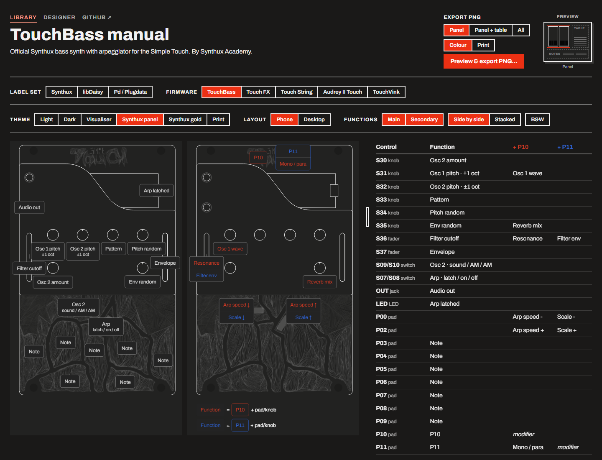
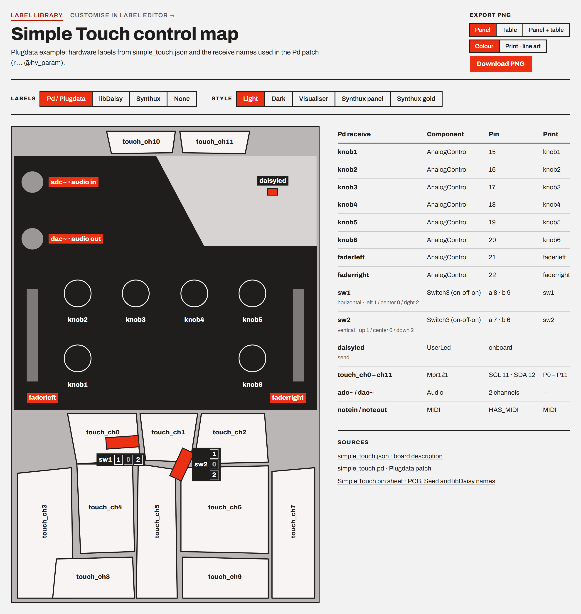
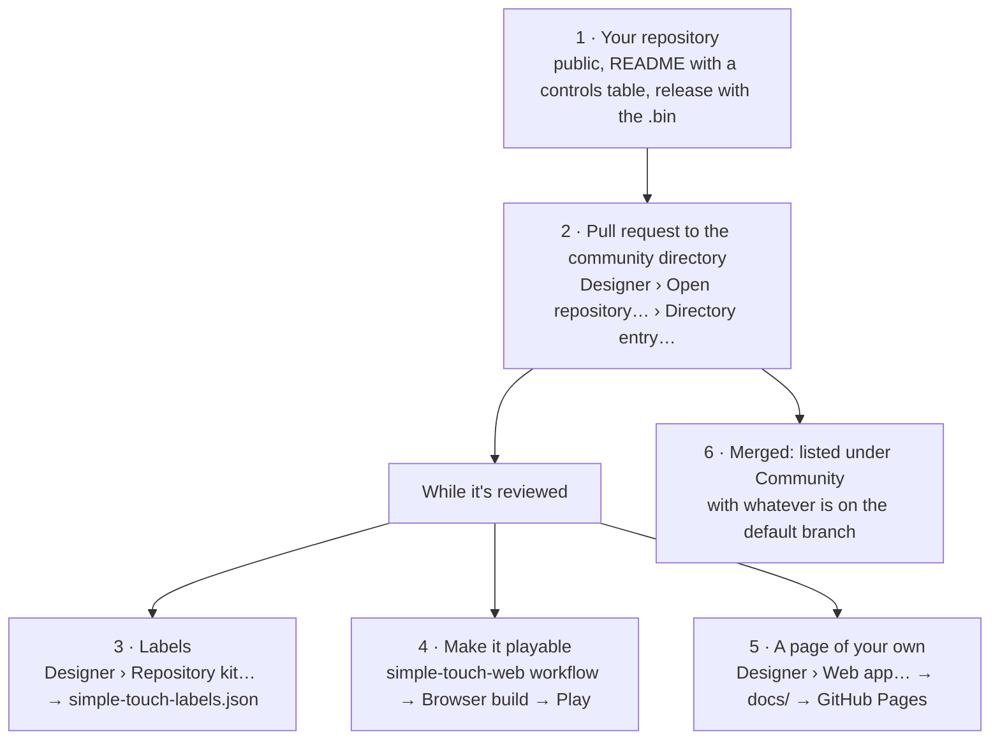

# Simple Touch labels

Control maps, manuals and a manual designer for the Synthux Simple Touch (Daisy Seed).

- **Library**: https://jonwaterschoot.github.io/simple-touch-labels/
- **Designer**: https://jonwaterschoot.github.io/simple-touch-labels/editor.html

To run it locally, serve the folder over HTTP (e.g. `python -m http.server`). The pages load `assets/panel_blank.svg` with `fetch`, so they don't work opened as files.

## Examples

| Library · TouchBass · Synthux panel | Library · Pd / Plugdata · Light |
| --- | --- |
|  |  |

## The whole route

The [guide](https://jonwaterschoot.github.io/simple-touch-labels/guide.html) has each step with its checks.

## Pages

- `index.html`: the library. Three tabs, each with a dropdown, pick what it shows. Accepts `?src=sx|ld|pd|touchbass|touchfx|touchstring|audreytouch|touchbloop&theme=…&layout=phone|desktop`.
  - **Official**: manuals for TouchBass, Touch FX, Touch String, Audrey II Touch and TouchBloop, with labels checked against each firmware's repo.
  - **Community**: the Simple Touch entries of the [Synthux community directory](https://synthux-academy.github.io/community-instruments/) (read from its `projects.json`, leaving out the official ones). Open one with `?community=<id>`.
  - The Community tab opens on a card per firmware, and **All firmware** returns to them. `?all` opens them. A card shows what `community-index.json` holds: Play, live link, OLED, where the labels come from and the latest release. Its picture is `listing.image` if the label file names one, else the panel without labels in the creator's theme and panel colours.
  - **DIY wiring**: the bare PCB with Synthux, libDaisy or Pd / Plugdata names and their pin tables, for building the kit or writing a firmware.
  - **Labels**: from the repository's `simple-touch-labels.json` if it has one (made in the designer). Otherwise they are auto-extracted from its README and a linked manual, marked as such with the line each label came from, one mode at a time when the README has a section per switch position (`### Seq (SW2 Up)`). Controls without a label show the Synthux names.
  - **README**: the repository's own, folded away below every firmware (official and community). Opened, it is read from the default branch and drawn as GitHub draws it, with relative paths pointing to the repository. The [about page](https://jonwaterschoot.github.io/simple-touch-labels/about.html#readme) lists what it renders.
- **Creator theme**: a label file made in the designer carries its creator's look (colours, sizes, drawing, a Google font) and can name a faceplate SVG in the same repository. The library then shows it in that look first, as the Creator theme at the top of the **Theme** dropdown, next to its own; the faceplate shows in every theme. Values from the file pass only as plain numbers, colours and known words, and the faceplate is cleaned like an upload. `?preview` shows the designer's current state in this browser the same way, and follows its edits.
- **Play**: when a firmware's label file has a browser build its author approved (an `emulator` block, see below), the library shows a Play button and runs the firmware in the page, built with [simple-touch-web](https://github.com/jonwaterschoot/simple-touch-web). TouchVink is the first. Its LED and OLED show on the panel.
  - **Mouse**: drag the knobs and faders on the drawing, click the levers, press the pads (higher up on a pad is harder). Right-click a pad to keep it held for a combo, right-click again to let go.
  - **Keyboard**: plays the pads by key position: 3 4 · W E R · A S D F G · X V on QWERTY, " ' · Z E R · Q S D F G · X V on AZERTY (the key names follow the layout you pick).
  - **Web MIDI**: connects a MIDI keyboard to the firmware's USB MIDI input and its output to a device.
  - **Control table**: lights the rows of the controls in use and shows the last MIDI message in and out. When the label file gives the controls' MIDI, each control's row also shows its last value in or out, and a note into a pad's note presses that pad on the drawing.
  - **Highlight**: a control, its label and its table row light together: lightly while you point at any of them (also when not playing), strongly while the control is in use or MIDI moves it.
  - **Phone**: Lock scroll (on by default on touch screens) keeps touches on the drawing from scrolling the page. Full screen shows the drawing alone, with the sound controls in a sheet and the **Labels** button. On iPhone, which has no full screen for web pages, the drawing covers the page instead.
  - **Input**: a loop, the mic or a sound file of your own.
- **Upload to device…**: on a firmware in the library and in the web app. Pulls the `.bin` of the repository's latest release, shows whether it runs from internal flash or needs the Daisy bootloader (QSPI or SRAM), with the steps for that case, and writes it with **Connect and flash**.
  - **Source**: GitHub or Codeberg releases, through `proxy/firmware-proxy.js` (release downloads send no CORS header). GitHub's sha256 is checked in the page. Without a release or a proxy, the dialog takes a file from this computer.
  - **Directory entry**: when the firmware's entry in the community directory has a `firmware` block, its `asset_pattern` picks the `.bin` in a release with several, and a `min_bootloader` newer than v6.4 adds a warning.
  - **Mode check**: the page reads which DFU the Daisy is in and writes nothing if it is the wrong one for the firmware.
  - **Daisy bootloader**: when a firmware needs it, **Install bootloader** writes libDaisy's v6.4 build (built-in USB port, 2-second wait) to internal flash. It needs a firmware built with libDaisy v5.3 or newer.
  - Uploading needs WebUSB (Chrome or Edge, over HTTPS or on localhost).
- `editor.html`: the designer. Accepts `?start=blank|touchbass|touchfx|touchstring|audreytouch|touchbloop&ref=sx|ld|pd&theme=…&layout=…`, `?community=<id>` (a directory entry's name, author and repository, with the labels the library found), `?repo=<repository URL>` (the same for any GitHub or Codeberg repository, listed or not) or `?s=<share link>`. State is kept in this browser (localStorage `simpleTouchManual.v1`).
- `player.html`: one firmware's manual as a site of its own, with Play: the page the designer's **Web app…** exports as `index.html`. Online it reads `simple-touch-labels.json` from the root of the firmware's repository (so a newly approved build shows without a new export); on localhost, or when the repository can't be read, the copy beside it. Without a copy, `?repo=<repository URL>` picks one; `?preview` shows the designer's current state in this browser and follows its edits.
- `guide.html`: step by step from a firmware to the library and the community directory, with checks that this browser remembers. Starts from an existing repository or from scratch, libDaisy or Plugdata; a repository URL at the top fills in the links (Releases, Actions, the raw label file, Pages), and **Check** (or Enter) reads a GitHub repository: public, README and control table, a release with a .bin, the label file, a browser build, a directory entry. It ticks the checks it confirms and never clears one. Ends with the minimum for a firmware README and a template, for any author (`#readme-minimum`).
- `about.html`: the whole route from firmware to library (a flowchart with an anchor per step, `#step-0` … `#step-5`), how the library, firmware repositories and the community directory fit together, how labels are found, and how creators publish theirs (including a README layout the extractor reads).

Both pages:

- **Themes**: Light, Dark and Visualiser (the simplified drawing), Synthux panel (the default), Synthux gold and Synthux light (the Synthux drawing). Each theme can use either drawing. The library and web app pick one from the **Theme** dropdown.
- **Labels** (library and web app, also in full screen): in the toolbar, and under the drawing with **⛶ Full screen** while it plays or follows a board. One button steps through **All labels**, **No pad labels** (pads and switches, with their leader lines), **Faceplate** (only the faceplate labels, when the file has them, also on a layout set to off) and **No labels**.
- **Layouts**: phone (label boxes on the controls) and desktop (side columns with leader lines). Labels lay themselves out; knob labels hang just below their knob.
- **Main and secondary functions**: up to four modifiers, held (P10 + knob), tapped (a mode switch, as in TouchVink) or held together (P10 + P11 + knob, as in TouchSpore, saved as `combos`), shown side by side or stacked, with a legend and a black-and-white print style.
- **Export / print…**: a preview popup where you drag the drawing to the size you want (or fit it to A4 / Letter), set the margin, panel gap, table gap and text size with sliders, then download a PNG or PDF (panel, table and notes) or print it; the export minimap in the header shows what is included.

The designer adds:

- **Hiding a control**: `-` in Line 1 leaves the control out of the main view: no label box, reference name or name on the drawing, and no row in the control table unless it has modifier text or MIDI. Its modifier text stays on the secondary view. A mode can set `-` or its own text for that mode. Saved as `"main":"-"`.
- **Fonts per part**: under Style › Fonts, Line 1, Line 2, Control names and Faceplate labels can each have their own font and weight. Modifier text follows the line size it is drawn at. Saved as `design.fonts` (`{"line2":{"family":"DM Mono","weight":500}}`). The library and web app load Google Fonts only.
- **Extra label style**: **Style** on an extra label's row sets its font, weight, line sizes, text, box and outline colours and outline thickness. Saved as `style` on the label. Synthux light, the Print export and B&W leave out the colours, and the library uses the style in the Creator theme only.
- **Labels tab**: firmware name and description, line 1 / line 2 per control, modifier columns, a MIDI column (e.g. `CC 20`, `note 36 ch 10 · CC 31`, `CC 30 ≥ 64`, `CC 21 = 3`: several separated by `·` or a comma, channels from 1, none = any channel; shown in the control table and saved as `midi` per label), reference names as captions or fill-ins, extra free labels, drag to nudge any label, Markdown notes, control table (filled or blank rows).
- **Style tab**: faceplate upload (SVG or image; it is left out inside the knobs, faders and jacks, and is saved as a file at a path in your repository: an image as the image, e.g. `img/faceplate.jpg`, an SVG as `img/faceplate.svg`; its placement stays in the label file) with area (whole panel or top plate), blend mode, opacity, position and scale, plus a layered SVG template and a PNG template; the drawing and its colours per theme; modifier colours; label boxes (sizes, reference caption size, fill opacity, drop shadow or glow, separate pad colours); secondary-view style.
- **Modes**: when a switch changes what the other controls do (a playmode switch), name its positions. Each becomes a button in the Mode row.
  - **Print set**: the labels outside any mode, what a printed panel shows, as wide as fits every mode. A mode keeps only the labels that differ (`-` for none in that mode).
  - **Fill the modes from the README** reads a README with a heading per switch position (`### Seq (SW2 Up)`).
  - **Format**: `modes` next to `labels`: `{"switch":"S07_S08","list":[{"pos":"up","name":"Seq","labels":{"S31":{"main":"Tempo"}}}]}`, so readers of `simple-touch-manual/3` still see the full print set.
  - **Library and web app**: a Mode row. While the browser build plays, the labels follow the switch. The downloaded manual has a button and a printed page per mode.
  - **PNG / PDF export**: any modes on the sheet, in the order you set, with a caption each and a table comparing them, or a page per mode. **Per row** sets how many drawings share a row (Auto tries each on A4 / Letter).
- **Browser build**: **Find builds in the repository** lists the builds on the firmware's `simple-touch-web` branch (newest first, with a test bench link); **Use this build** approves one. Or paste the `emulator` block from a [simple-touch-web](https://github.com/jonwaterschoot/simple-touch-web#publishing-a-build) build's run summary to approve that build. `"embed": "allowed"` lets the library play it, `"link-only"` with a `"url"` links to the author's own page, and `"oled": true` shows the OLED. The build must come from the firmware's repository (raw files or its owner's Pages), and its `sha256` pins it.
- **Colours**: each colour opens a picker with the colour it had before (click to go back), the colours you used recently, a field for hex or `rgba(r, g, b, a)`, R, G, B and A fields with an opacity slider, and the system picker. A see-through colour is saved as `#rrggbbaa`.
- **Preview in library**: opens the library on your manual as it will look there, in a tab that follows your edits.
- **ALL CAPS**: under Style › Label boxes, per layout: every label on the drawing in capitals. What you typed stays as typed, also in the control table, and the setting is saved with the design.
- **Turning labels**: select a label on the preview (or focus its row) and press **CW** or **CCW** by the preview for a quarter turn, per layout. The layout makes room for the turned box. Saved as `r` next to the label's position in `offsets`; **Reset positions** turns the layout's labels back.
- **Faceplate per layout**: under Style › Faceplate, **The desktop layout has its own faceplate** gives the desktop layout the same art with its own placement, art of its own, or no faceplate. Saved as `fpDesktop` (`{"art":"own","faceplate":"img/faceplate-desktop.svg","style":{…}}`); Save file, the Repository kit and the Web app bring its file along.
- **Faceplate labels**: under Style, the check mark **Design labels on the faceplate** opens a tab for text that is part of the faceplate, with no box. Each control takes its line 1 (of the print set) until you type something else; `-` leaves it out. Per layout: off, with the label boxes or instead of them, text size and colour. Drag and turn each one on the preview, per layout. Saved as `fpLabels`, placed as `offsets` key `f:<id>`, colour as `fpl` per theme and layout.
- **OLED**: under Style, or dragged on the preview: where the display sits on the drawing and how wide it is, per layout, saved as `oled` in the label file. Its height follows the display, 128 × 32 or 128 × 64.
- **Control names**: under Style, per layout: the small names such as P1 or S36 in the text labels or on the drawing (a knob's name inside the knob), with their size and position. On the drawing, each can be dragged by itself.
- **Undo**: Ctrl+Z undoes the last change (labels, style, font), Ctrl+Shift+Z or Ctrl+Y redoes it.
- **Fonts**: any Google Font by name, or a CSS URL (Adobe Fonts projects work too).
- **Files**: save and open JSON (Fabio Bartali's `simple-touch-manual/3` format, plus extras), open a README (`.md`) to fill in the labels and modes it names (the firmware fields and design stay), copy a compressed share link, download a standalone manual page (phone and desktop layouts, screen and print versions).
- **Open repository…**: any public GitHub or Codeberg repository, listed in the community directory or not. Reads its `simple-touch-labels.json`, or else the labels a script finds in its README and a linked manual. A repository not in the directory takes its name and owner from the URL.
- **Repository kit**: one .zip for the firmware's repository, previewed before download: a README (intro, control map PNG, control table, notes, suggested install and build steps for libDaisy or Plugdata, internal flash or the Daisy bootloader, with TODOs for the creator), `simple-touch-labels.json`, the community directory entry and a short HOW-TO.
- **Web app…**: your manual as a site for GitHub Pages, in one .zip: `player.html` as `index.html`, the code and drawing it runs on, a copy of the label file and faceplate, and `HOW-TO-PAGES.md` (copy the folder into `docs/`, then Settings › Pages › Deploy from a branch › /docs). The dialog shows the same steps, the address it will have, what is missing (no repository, no approved build), and a preview that follows your edits.
- **Settings and presets**: a label file with a `device` block gets buttons, lists and presets under Play, in one mode at a time. A setting whose buttons are the 12 note names shows as one octave of keys. The format is in [simple-touch-web's README](https://github.com/jonwaterschoot/simple-touch-web#settings-and-presets). Add the block to the file by hand: the designer keeps it but can't edit it yet.
  - **Play in browser**: the firmware in the page. One device can't be both MIDI in and MIDI out, because the two would feed each other.
  - **Connect to Simple Touch**: a real board over Web MIDI, with no firmware running in the page. A firmware with a `device` block and no browser build only gets this mode. With a `live` section in the block it also shows the board on the drawing (pads, levers, knobs, OLED, mode labels), and the knobs and pads on the drawing move the board.
- **Directory entry**: builds `projects/<id>.json` for the Synthux community directory from the firmware name, author, repository and author link, checks it against the directory's schema and existing entries, and opens a pull request on GitHub with the file filled in (or the existing file, if the repository is already listed).

## Files

- [SPEC.md](SPEC.md): what a firmware repository carries, and the format of `simple-touch-labels.json`. `schema/simple-touch-labels.schema.json` is the same as a JSON Schema.
- `core.js`: slots, reference names, themes, the layout engine, both drawings, faceplates, fonts, Markdown, share links and exports. Shared by both pages.
- `play.js`: Play. The panel's controls as an interactive layer over the drawing, the audio chain (input, firmware, volume, limiter), the LED and OLED. It loads the runtime in `vendor/simple-touch-web/` (simple-touch-web's `web/`, tag `v1`, ABI `simple-touch-web/1`) on the first Play.
- `flash.js`: **Upload to device…**. Reads the latest release, finds where a `.bin` runs from its reset vector (`firmwareKind`) and writes it with `vendor/webdfu/` (Electrosmith's Programmer, unchanged, MIT and ISC). `FIRMWARE_PROXY` holds the deployed proxy's URL.
- `proxy/`: a Cloudflare Worker that serves release `.bin` files with a CORS header, to pages on `github.io`, `codeberg.page` and localhost. Deploy it with `npx wrangler deploy` in that folder.
- `community.js`: the community directory (`projects.json`), reading firmware repositories on GitHub and Codeberg (`simple-touch-labels.json`, `README.md` and a linked manual), the README label extractor, and the README view (marked, then DOMPurify; mermaid in strict mode). Repository text is shown escaped or sanitised, never run, and a repository's faceplate is cleaned like an upload.
- `community-index.json`: a snapshot of the directory's Simple Touch repositories for the cards (`format` `simple-touch-index/1`). `scripts/community-index.mjs` writes it, and `.github/workflows/community-index.yml` runs that daily and commits the file when it changed. It holds no date.
- `ui.css`: page chrome; `styles.css`: base typography (`Archivo`) and colour tokens.
- `examples/*.json`: firmware labels and notes, from the [TouchBass](https://github.com/Synthux-Academy/TouchBass), [TouchFX](https://github.com/Synthux-Academy/TouchFX), [TouchString](https://github.com/Synthux-Academy/TouchString), [AudreyTouch](https://github.com/Synthux-Academy/AudreyTouch) and [TouchBloop](https://github.com/Synthux-Academy/TouchBloop) repos. The Touch FX and Touch String faceplates go in `examples/faceplates/` (`touchfx.svg`, `touchstring.svg`), which is kept out of the repository until the artwork is cleared. Where the files are present, the pages show them; elsewhere these examples use the blank faceplate.
- `assets/panel_blank.svg`: the Synthux panel drawing with a blank faceplate. Its colours are CSS custom properties (`--pbg`, `--pline`, `--pshape`, `--pmid`, `--ptop`, `--pctl`, …), so one file serves every theme. The simplified drawing is generated in `core.js`.
- `assets/simple_touch_pd.png`: screenshot of `simple_touch_template.pd`; `assets/example_*.png`: the screenshots above; `assets/favicon.svg`, `assets/social_preview.png`: tab icon and 1280×640 social preview.

External at runtime: html-to-image (jsDelivr) for PNG and PDF export, Google Fonts for the label fonts. When a README is opened: marked, DOMPurify and, for a README with a flowchart, mermaid (jsDelivr, pinned by hash), and the README's own images and videos. When Play is pressed: the approved build from the firmware's repository, and the loops from simple-touch-web's Pages. When **Upload to device…** opens: the repository's release list (GitHub or Codeberg API) and its latest `.bin` through the proxy.

## Sources

- json: https://github.com/Wasted-Audio/hvcc-examples-daisy/blob/main/simple_touch.json
- pd: https://github.com/Wasted-Audio/hvcc-examples-daisy/blob/main/simple_touch_template.pd
- pin sheet: https://docs.google.com/spreadsheets/d/1xtg_s1tk8tm-6qNkBLFc6V1L_Mpmu-PCOvv7qEyr9mU/edit?usp=sharing
- Firmware: [TouchBass](https://github.com/Synthux-Academy/TouchBass), [TouchFX](https://github.com/Synthux-Academy/TouchFX), [TouchString](https://github.com/Synthux-Academy/TouchString), [AudreyTouch](https://github.com/Synthux-Academy/AudreyTouch)
- Touch FX manual (Fabio Bartali): https://bartali.nl/touch-fx-manual.html

## License & Credits

- **Repository code**: Licensed under the [MIT License](LICENSE).
- **`vendor/webdfu/`**: from Electrosmith's [Programmer](https://github.com/daisyaudio/Programmer) (MIT), based on Devan Lai's [webdfu](https://github.com/devanlai/webdfu) (ISC). Licences in `vendor/webdfu/LICENSE`.
- **`vendor/libdaisy/`**: the Daisy bootloader from [libDaisy](https://github.com/electro-smith/libDaisy) (MIT), copied unchanged with its licence.
- **Layout engine and manual format**: adapted from Fabio Bartali's Simple Touch Manual Designer (build 40).
- **Firmware faceplates (Touch FX, Touch String)**: Synthux Academy artwork, supplied via Fabio Bartali. Not in this repository until cleared, and excluded from the MIT license.
- **Simple Touch panel drawing (`assets/panel_blank.svg`)**: Excluded from the MIT license. Original drawing created by Roey Tsemah (founder of [Synthux Academy](https://synthux.academy)), sourced and adapted via Fabio Bartali's [Touch FX manual](https://bartali.nl/touch-fx-manual.html). All rights to the original Simple Touch panel artwork and hardware design remain with Roey Tsemah / Synthux Academy.

## Open items

- Confirm `Switch3` pin_a / pin_b orientation on hardware.
- The simplified drawing's pad shapes come from the old label editor's sketch and are approximate.
